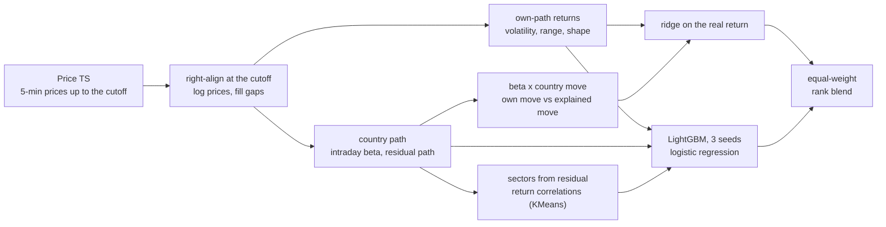

# Beating the country in the last 30 minutes

**QRT × Analytics Club ETH Zürich Data Challenge, 24 November 2026: 8th of 37 teams.**

In two hours on Kaggle, predict for 386 European stocks whether each one will beat or trail its
own country over the last 30 minutes of the trading day, from nothing but its 5-minute prices up
to that point. Scoring is accuracy on the sign, with every stock-day weighted by the size of its
move.

| | weighted accuracy (private test set, 199 days) |
|---|---|
| Host benchmark (short-term reversal of the last bar) | 0.5227 on train |
| Our LightGBM baseline | 0.5337 |
| **Our final blend** | **0.5436** |
| Winning team | 0.5456 |

At this signal-to-noise level a good model is right on about 54% of the weighted moves, and the
top eight teams finished within about 0.2 points of each other. The work that mattered was building
features that isolate each stock's own move, keeping the validation honest, and not chasing a
leaderboard that turned out to be scoring the training data.

## Approach



1. **Isolate the stock's own move.** The target is already relative to the country, so what
   matters is the part of a stock's late-session move that its beta to the country does not
   explain. We fit a per-day intraday beta to the equal-weighted country path and split every
   return into a beta-driven part and an idiosyncratic part. Only the idiosyncratic part reverts
   before the close. Removing the two `beta × country move` columns costs the ridge model 0.55
   accuracy points, the largest single effect we found.
2. **Recover the missing sector structure.** The data has no sector column, so we clustered the
   stocks on the correlation of their country-residual 5-minute returns (KMeans, K = 25, features
   only) and added stock-vs-sector and sector-vs-country moves. That took LightGBM from 0.5416 to
   0.5436 in CV.
3. **Use models that suit a weak, nearly linear signal.** Ridge regression on the raw return
   (0.5420) beat LightGBM on the same features (0.5372). The trees only caught up with the richer
   residual-path features and three-seed bagging.
4. **Blend models that make different mistakes.** An equal-weight rank average of the sector
   LightGBM, a sector logistic regression and the intraday ridge gave our best private score.

## Validation and overfitting control

- **Folds of whole days.** Rows of one day share the market move, so cross-validation holds
  out whole days (5 date-block folds) and every model is scored with the competition's own
  weighted accuracy.
- **The public leaderboard was scoring the training rows.** Our LightGBM baseline scored 0.6631
  on the public leaderboard, exactly its in-sample accuracy on the training ids, against 0.5329
  in CV. We stopped looking at it and chose every submission on CV. That choice held: the
  submission that topped our public scores finished last on the private test set.
- **The test period is calmer.** Adversarial validation separates train from test days with AUC
  0.84 (volatility, stocks per day). Every candidate was re-scored on the most test-like training
  days before it was submitted.
- **Tuning checks.** A day bootstrap showed the top candidates were statistically tied. Re-running
  the CV on three fresh random partitions of the days showed that two post-processing tweaks only
  helped on the folds they were tuned on, so we dropped them.

The full write-up, with every CV number, the negative results (CNN, GRU, supervised
autoencoder, splines, per-country slopes and more) and the CV-vs-private table for all ten
submissions, is in **[docs/METHOD.md](docs/METHOD.md)**.

## What is in the repository

```
src/qrtc/                 tested toolkit (88% coverage): spec loading, leak-safe CV, 16 metrics,
                          model zoo, CV loop with OOF/test predictions, run registry, blending,
                          submission validation, EDA with leakage checks and adversarial validation
competition.toml          the problem spec every script reads (files, target, metric, CV)
experiments/
  intraday_ridge/         feature builder, ridge, neural nets, robustness checks, feature variants
  residual_gbm/           residual-path features, recovered sectors, LightGBM / logreg / ridge
  cnn_path/               1D CNN on the scale-free relative price path
  validation/             data audit, shift-aware score estimates, paired gain gate
  xgboost_gpu/            XGBoost notebooks for Colab and Kaggle GPUs
results/registry/         metadata of all 112 runs (CV mean, std, fold scores, features, params)
notebooks/                quickstart, EDA, experiment template, blend and submit
tests/                    pytest suite on five synthetic datasets shaped like past QRT challenges
docs/METHOD.md            the write-up
```

The toolkit was written before the event and tested on synthetic data shaped like past QRT
challenges. On the day, only the spec and the feature code had to be written. Everything runs
through one spec, one set of folds and one metric, so every run is comparable and any two runs
can be blended from their saved out-of-fold predictions.

## Reproduce

Requires Python 3.12 and [uv](https://docs.astral.sh/uv/). The competition data is not included.

```bash
make setup                                   # dependencies, git hooks, Jupyter kernel
D=data/raw/qrt-x-eth-hackathon-24-11-2026
kaggle competitions download -c qrt-x-eth-hackathon-24-11-2026 -p $D && unzip -o $D/*.zip -d $D

make prep                                    # flat baseline features (competition.toml)
make features                                # data/derived/: 45 intraday features per stock-day
make ridge                                   # ridge: CV 0.54196 ± 0.00521

# residual-path LightGBM with sectors, 3 seeds (CV 0.5436)
uv run python experiments/residual_gbm/run.py --base spec --fit-weight --seeds 3 \
    --families beta,idio --sectors 25

uv run qrtc lb                               # every run, best CV first
uv run qrtc blend RUN_A RUN_B RUN_C --method rank
make check                                   # ruff + pytest + notebook check (as in CI)
```

`make ridge` reproduces the event's ridge run exactly, fold by fold. Torch models need
`uv sync --extra fm` and run on Apple-Silicon (MPS) or CUDA.

**Stack:** Python 3.12, pandas, NumPy, scikit-learn, LightGBM, XGBoost, PyTorch, pytest, ruff,
GitHub Actions.

## Team

LARP STREET TRADING (Kaggle: cangktan, itheclixs, mer123haba456, tugrulox). Unofficial team
repository, not affiliated with or endorsed by QRT or ETH Zürich. MIT licence.
